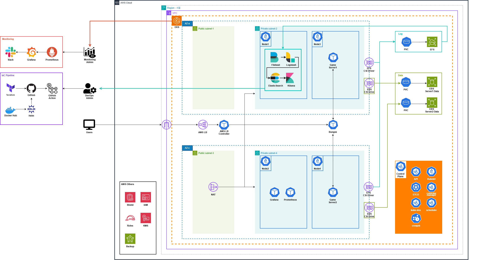
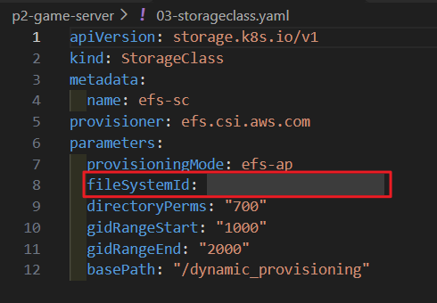
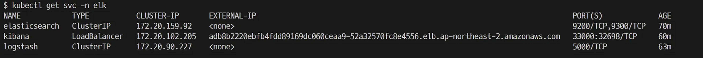

# CoreOrbit: EKS 기반 Minecraft 플랫폼

Terraform으로 AWS 네트워크와 EKS 클러스터를 만들고, Amazon EFS를 공유 저장소로 사용하는 Minecraft 서버 두 대와 BungeeCord 프록시, ELK 로그 분석 스택을 Kubernetes에 배포하는 프로젝트입니다.
실제 AWS 배포 전에는 계정 권한, 리전, 비용, 네트워크 및 아래의 LoadBalancer 검토사항을 확인하세요.

## 주요 구성

- **인프라**: Terraform 모듈로 VPC, 서브넷, IGW, NAT Gateway, 라우팅 테이블, EKS 및 관리형 노드 그룹 생성
- **게임 서비스**: Minecraft서버 2대와 BungeeCord Helm 차트
- **공유 저장소**: Amazon EFS CSI Driver, StorageClass, PVC
- **로그 분석**: Filebeat → Logstash → Elasticsearch → Kibana

## 자동 검사 (GitHub Actions)

`main` 브랜치에 push하거나 `main`을 대상으로 PR을 만들면 Terraform 설정을
검증하고, BungeeCord Helm 차트와 p2·p3의 일반 YAML 파일 문법을 검사합니다.
검사 결과는 GitHub의 Actions 탭에서 확인할 수 있습니다.
AWS에 접속하거나 `terraform plan` 또는 `terraform apply`를 실행하지 않으며,
YAML 문법 검사는 Kubernetes에서 정상 배포되는지까지 확인하지는 않습니다.

## 아키텍처 개요



## 저장소 구조

```text
.
├── p1-infra-base/
│   ├── infra/                    # Terraform root module과 변수
│   └── modules/
│       ├── network/              # VPC, subnet, IGW, NAT, routes
│       └── eks/                  # EKS, IAM, node group, addons
├── p2-game-server/               # EFS 설정, Minecraft YAML, BungeeCord Helm chart
└── p3-log-analysis-ELK/          # Elasticsearch, Filebeat, Logstash, Kibana
```

## 사전 준비

### 도구와 계정

- AWS 계정과 필요한 IAM 권한, AWS CLI
- Terraform 1.5 이상
- Helm
- `kubectl`
- `eksctl`
- AWS 프로필을 설정합니다.
    ```bash
    aws configure
    ```
- 배포할 계정과 리전을 확인합니다. 아래와 같은 정보가 뜨면 성공입니다.
    ```bash
    aws sts get-caller-identity
    {
    "UserId": "AIDAXXXXXXXXXXXXXXXXX",
    "Account": "123456789012",
    "Arn": "arn:aws:iam::123456789012:user/your-iam-user"
    }
    ```

### EKS를 위한 키페어

- Terraform의 EKS 관리형 노드 그룹은 `키페어`가 필요합니다. 
- AWS console에서 EKS 배포와 동일한 리전을 선택합니다.
- EC2 항목을 선택하고, `키페어`를 생성합니다.
- 다운로드한 개인 키 파일은 안전한 로컬 위치에 보관합니다.

### 테라폼 변수 설정
`p1-infra-base/infra/terraform.tfvars`의 필수 변수값은 모두 설정해야 합니다. 
- 네트워크 변수
    - region
    - VPC CIDR
    - 2개의 public subnet CIDR · AZ suffix · 이름
    - 2개의 private subnet CIDR · AZ suffix · 이름
    - NAT용 public subnet key
- EKS 변수
    - cluster name/version
    - node group name
    - instance type
    - desired/min/max 개수
    - node volume 크기
    - `node_key_name`에는 앞서 생성했던 `키페어`이름을 입력합니다.
        ```hcl
        node_key_name = "<AWS에 등록한 키페어 이름>"
        ```
<br>
<br>
<br>

## 배포 흐름

### 1. Terraform으로 네트워크와 EKS 생성

`p1-infra-base/infra`의 root module이 `modules/network`와 `modules/eks`를 함께 호출합니다. 따라서 Terraform 적용 한 번으로 기본 네트워크 인프라 및 EKS를 생성합니다.

- `terraform plan`에서 생성될 리소스를 확인합니다. 의도치 않은 리소스나, 잘못된 변수가 있을 경우, 진행하지 말고 변수와 state를 확인하세요.
    ```bash
    cd p1-infra-base/infra
    terraform init
    terraform validate
    terraform plan
    ```

- `terraform apply`로 AWS 리소스를 생성합니다. 모든 리소스 생성까지 약 10분의 시간이 소요됩니다.
    ```bash
    terraform apply
    ```

- Terraform이 출력한 클러스터 이름과 `terraform.tfvars`에 설정한 리전으로 kubeconfig를 갱신합니다. REGION의 경우, terraform.tfvars의 region 값으로 변경합니다.
    ```bash
    AWS_REGION="ap-northeast-2"
    CLUSTER_NAME=$(terraform output -raw cluster_name)
    cd ../..
    ```
    ```bash
    aws eks --region "$AWS_REGION" update-kubeconfig --name "$CLUSTER_NAME"
    ```

- 모든 노드가 `Ready`인지 확인합니다. 아래와 같은 결과가 나오면 정상적인 연결입니다.
    ```bash
    kubectl get nodes -o wide
    ```
    ```bash
    NAME                                           STATUS   ROLES    AGE   VERSION
    ip-192-168-1-100.ap-northeast-2.compute.internal   Ready    <none>   5m    v1.27
    ```

### 2. EFS CSI Driver의 IAM 서비스계정 및 드라이버

- EFS CSI Driver용 정책을 생성하고 ARN을 확인합니다.
    ```bash
    POLICY_ARN=$(aws iam create-policy \
        --policy-name AmazonEFSCSIPolicy \
        --policy-document file://p2-game-server/02-efs-csi-iam-policy.json \
        --query Policy.Arn \
        --output text)
    ```
- `eksctl create iamserviceaccount`는 기존 EKS의 OIDC와 IAM을 사용해 EFS CSI Controller 서비스계정을 연결하는 단계입니다.
    ```bash
    eksctl create iamserviceaccount \
        --cluster "$CLUSTER_NAME" \
        --namespace kube-system \
        --name efs-csi-controller-sa \
        --attach-policy-arn "$POLICY_ARN" \
        --approve \
        --region "$AWS_REGION"
    ```

- Helm으로 CSI Driver를 설치합니다. 아래 예시는 기존 workflow의 ap-northeast-2 이미지 저장소입니다. 다른 리전이라면 해당 리전의 ECR repository 주소로 바꿉니다.
    ```bash
    helm repo add aws-efs-csi-driver https://kubernetes-sigs.github.io/aws-efs-csi-driver/
    helm repo update
    helm upgrade --install aws-efs-csi-driver aws-efs-csi-driver/aws-efs-csi-driver \
        --namespace kube-system \
        --set image.repository=602401143452.dkr.ecr.ap-northeast-2.amazonaws.com/eks/aws-efs-csi-driver \
        --set controller.serviceAccount.create=false \
        --set controller.serviceAccount.name=efs-csi-controller-sa
    ```

### 3. Amazon EFS, mount targets, StorageClass 및 PVC

- AWS CLI로 EFS 리소스를 생성합니다. VPC ID와 CIDR을 조회하고, VPC CIDR에서만 NFS TCP 2049를 허용하는 EFS 보안 그룹을 만듭니다.
    ```bash
    VPC_ID=$(aws eks describe-cluster \
        --name "$CLUSTER_NAME" --region "$AWS_REGION" \
        --query 'cluster.resourcesVpcConfig.vpcId' --output text)
    
    VPC_CIDR=$(aws ec2 describe-vpcs \
        --vpc-ids "$VPC_ID" --region "$AWS_REGION" \
        --query 'Vpcs[0].CidrBlock' --output text)

    EFS_SG_ID=$(aws ec2 create-security-group \
        --group-name coreorbit-efs-sg \
        --description "EFS mount target access from the EKS VPC" \
        --vpc-id "$VPC_ID" --region "$AWS_REGION" \
        --query GroupId --output text)

    aws ec2 authorize-security-group-ingress \
        --group-id "$EFS_SG_ID" --protocol tcp --port 2049 \
        --cidr "$VPC_CIDR" --region "$AWS_REGION"
    ```

- EFS를 만들고 `FileSystemId`를 기록합니다.
    ```bash
    EFS_ID=$(aws efs create-file-system \
        --region "$AWS_REGION" \
        --performance-mode generalPurpose \
        --query FileSystemId --output text)
    aws efs wait file-system-available --file-system-id "$EFS_ID" --region "$AWS_REGION"
    echo "$EFS_ID"
    ```

- EKS 노드가 있는 private subnet과 AZ를 조회한 뒤, **노드가 사용하는 각 AZ마다 하나씩** mount target을 생성합니다.
    ```bash
    aws ec2 describe-subnets \
        --filters "Name=vpc-id,Values=$VPC_ID" \
        --query 'Subnets[*].{SubnetId:SubnetId,AZ:AvailabilityZone,CIDR:CidrBlock}' \
        --output table --region "$AWS_REGION"

    read -r -p "Private subnet ID in the first node AZ: " PRIVATE_SUBNET_1
    read -r -p "Private subnet ID in the second node AZ: " PRIVATE_SUBNET_2

    aws efs create-mount-target --file-system-id "$EFS_ID" \
        --subnet-id "$PRIVATE_SUBNET_1" --security-groups "$EFS_SG_ID" --region "$AWS_REGION"
    aws efs create-mount-target --file-system-id "$EFS_ID" \
        --subnet-id "$PRIVATE_SUBNET_2" --security-groups "$EFS_SG_ID" --region "$AWS_REGION"
    ```

- FilesystemID를 입력합니다. `p2-game-server/03-efs-storageclass.yaml`에서 `fileSystemId`를 방금 만든 ID로 수정하고 아래의 명령어를 통해 적용합니다.
<br>
    
    

    ```bash
    kubectl apply -f p2-game-server/03-efs-storageclass.yaml
    kubectl apply -f p2-game-server/04-efs-pvc.yaml
    kubectl get storageclass,pv,pvc
    kubectl get pods -n kube-system
    ```

- PVC가 `Bound`인지 확인합니다. CSI Controller의 실제 Pod 이름을 확인한 뒤 필요하면 로그를 봅니다.
    ```bash
    kubectl get pods -n kube-system
    CSI_POD=$(kubectl get pods -n kube-system -o name | grep efs-csi-controller | head -n 1)
    kubectl logs "$CSI_POD" -n kube-system -c csi-provisioner --tail=20
    ```

### 4. EKS 클러스터에 EBS CSI 드라이버 설치
- 클러스터와 기존 드라이버를 확인합니다.
    ```bash
    aws sts get-caller-identity
    aws eks describe-cluster --name "$CLUSTER_NAME" --region "$AWS_REGION" \
        --query "cluster.identity.oidc.issuer" --output text
    aws eks list-addons --cluster-name "$CLUSTER_NAME" --region "$AWS_REGION"

    kubectl config current-context
    kubectl get csidriver
    kubectl get deployments,daemonsets -n kube-system
    ```

- 드라이버용 IAM 역할을 생성합니다. 
    ```bash
    ROLE_NAME="AmazonEKS_EBS_CSI_DriverRole"

    eksctl create iamserviceaccount \
        --name ebs-csi-controller-sa \
        --namespace kube-system \
        --cluster "$CLUSTER_NAME" \
        --region "$AWS_REGION" \
        --role-name "$ROLE_NAME" \
        --role-only \
        --attach-policy-arn arn:aws:iam::aws:policy/AmazonEBSCSIDriverPolicyV2 \
        --approve
    ```

- EBS CSI 드라이버를 설치합니다. ARN을 조회하고 Add-on을 설치합니다.
    ```bash
    ROLE_ARN=$(aws iam get-role \
        --role-name "$ROLE_NAME" \
        --query "Role.Arn" \
        --output text)
    echo "$ROLE_ARN"

    eksctl create addon \
        --name aws-ebs-csi-driver \
        --cluster "$CLUSTER_NAME" \
        --region "$AWS_REGION" \
        --service-account-role-arn "$ROLE_ARN"
    ```    

- EBS CSI 드라이버가 정상적으로 설치되었는지 확인합니다. 
    ```bash
    aws eks wait addon-active \
        --cluster-name "$CLUSTER_NAME" \
        --addon-name aws-ebs-csi-driver \
        --region "$AWS_REGION"

    aws eks describe-addon \
        --cluster-name "$CLUSTER_NAME" \
        --addon-name aws-ebs-csi-driver \
        --region "$AWS_REGION"

    kubectl get pods -n kube-system
    kubectl get csidriver    
    ```

- EBS Storageclass와 pvc를 적용합니다.
    ```bash
    kubectl apply -f p2-game-server/05-ebs-storageclass.yaml
    kubectl apply -f p2-game-server/06-ebs-pvc.yaml
    ```


### 5. Minecraft 서버 배포

- 두 Deployment가 같은 `efs-claim` PVC를 사용합니다.
    ```bash
    kubectl apply -f p2-game-server/07-minecraft-server-1.yaml
    kubectl apply -f p2-game-server/08-minecraft-server-2.yaml
    ```

- Pod가 `Running`인지, 서비스가 NodePort `30001`과 `30002`를 사용하는지 확인합니다.
    ```bash
    kubectl get pods,svc -n default -o wide
    ```

### 6. BungeeCord Helm 차트 배포

- Helm을 이용해 Bungeecord 차트를 배포합니다. `values.yaml`의 `lobby`와 `game` 주소가 각각 `minecraft-service-1:25565`, `minecraft-service-2:25565`를 가리키는지 확인합니다.
    ```bash
    helm lint p2-game-server/07-helm-bungeecord
    helm upgrade --install bungeecord p2-game-server/07-helm-bungeecord --namespace default
    kubectl rollout status deployment/bungeecord -n default
    kubectl get pods,svc -n default
    ```

### 7. ELK 로그 분석 배포

ELK 리소스는 `elk` namespace, Filebeat는 `default` namespace에 배포됩니다. 과거 ELB hostname은 재사용하지 말고 같은 클러스터의 Kubernetes 서비스 DNS를 사용하도록 ConfigMap을 확인합니다.

#### 7.1 Elasticsearch

- 현재 manifest 순서대로 적용하고 StatefulSet이 준비됐는지 기다립니다.
    ```bash
    cd p3-log-analysis-ELK/01-elasticsearch    #저장소 루트에서 시작
    kubectl apply -f 01-elk-namespace.yaml
    kubectl apply -f 02-elasticsearch-configmap.yaml
    kubectl apply -f 03-elasticsearch-persistentvolume.yaml
    kubectl apply -f 04-elasticsearch-statefulset.yaml
    kubectl apply -f 05-elasticsearch-service.yaml
    kubectl rollout status statefulset/elasticsearch-node -n elk
    kubectl get pods,svc -n elk
    ```

#### 7.2 Logstash

- `p3-log-analysis-ELK/02-logstash/01-logstash-configmap.yaml`에서 elasticsearch의 `ID`와 `비밀번호`는 테스트 목적성을 가지므로 암호화하지 않았습니다. 실제 서비스 상황에서는 주의해야합니다.
    ```bash
    cd ../02-logstash
    kubectl apply -f 01-logstash-configmap.yaml
    kubectl apply -f 02-logstash-deployment.yaml
    kubectl apply -f 03-logstash-service.yaml
    kubectl get pods,svc -n elk
    ```

#### 7.3 Filebeat

- `p3-log-analysis-ELK/03-filebeat/01-filebeat-configmap.yaml`의 `setup.kibana`의 주소는 Filebeat에서 제공하는 대시보드를 Kibana에 미리 설치하기 위해 사용합니다. 
    ```bash
    cd ../03-filebeat
    kubectl apply -f 01-filebeat-configmap.yaml
    kubectl apply -f 02-filebeat-deployment.yaml
    kubectl get pods -n default
    ```

#### 7.4 Kibana

- Kibana ConfigMap의 `elasticsearch.hosts`와 Deployment의 `ELASTICSEARCH_HOSTS`가 같은 내부 Elasticsearch 주소를 사용하도록 맞춥니다.
    ```bash
    cd ../04-kibana
    kubectl apply -f 01-kibana-configmap.yaml
    kubectl apply -f 02-kibana-deployment.yaml
    kubectl apply -f 03-kibana-service.yaml
    kubectl get pods,svc -n elk
    cd ../..
    ```

### 7. ELK 동작 확인
- 배포한 Filebeat와 Logstash를 확인합니다. 
    ```bash
    kubectl get nodes
    kubectl get pods,svc -A
    kubectl logs deployment/filebeat -n default
    kubectl logs deployment/logstash -n elk
    ```

- Elasticsearch Pod 이름을 조회한 뒤 로컬에서 API를 확인합니다.
    ```bash
    kubectl get pods -n elk
    kubectl port-forward pod/<elasticsearch-pod-name> 9200:9200 -n elk
    ```

- 포트포워딩이 유지되는 동안, 다른 터미널에서 아래 명령어를 실행합니다.
    ```bash
    curl -sS "http://localhost:9200/_cluster/health?pretty"
    curl -sS "http://localhost:9200/_cat/indices?v"
    ```

- Kibana는 `kubectl get svc -n elk`로 서비스 포트를 확인합니다.
    